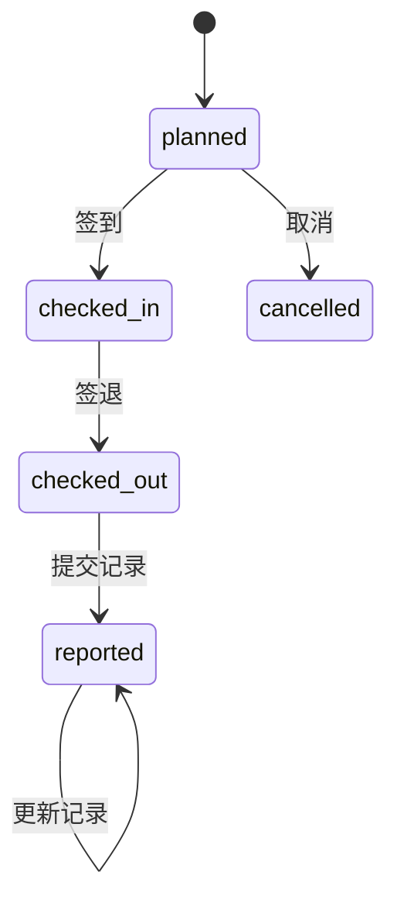
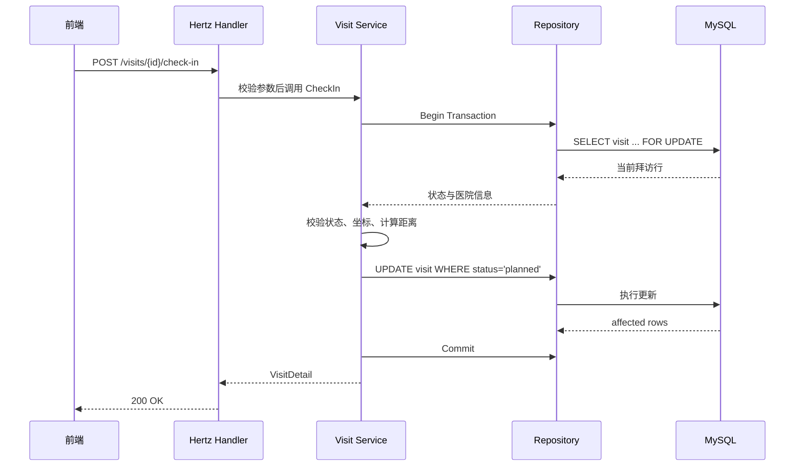

# 医药代表学术拜访管理系统 - 后端开发设计文档

| 项目 | 内容 |
|---|---|
| 文档版本 | v1.0 |
| 编写日期 | 2026-11-05 |
| 设计依据 | [spec.md](spec.md) |
| 后端技术栈 | Go + Hertz + GORM + MySQL 8 |
| 适用范围 | 后端 Schema、接口、业务逻辑、合规算法、测试与部署 |
| 文档状态 | 设计定稿，待实现 |

## 目录

1. 概述
2. 总体架构
3. 数据表设计
4. 状态机设计
5. 合规算法
6. 业务逻辑流程
7. API 设计
8. 项目结构
9. 配置与部署
10. 测试设计
11. 风险与假设
12. 后续扩展

---

## 1. 概述

### 1.1 业务背景

医药代表（MR）需要向医生（HCP）传递具体产品的学术信息，该沟通过程称为拜访。医疗 CRM 对拜访记录有严格的真实性与合规性要求：不仅要记录沟通内容，还要证明代表确实到达医院、停留时间合理、沟通地点合规。

典型拜访流程：

1. **拜访计划（Plan）**：MR 预约要拜访的医生、医院与目标科室。
2. **现场签到（Check-in）**：MR 到达医院后签到，系统记录 GPS 坐标与进入时间。
3. **学术沟通（Detailing）**：MR 向医生展示产品学术资料或临床数据。
4. **拜访签退（Check-out）**：沟通结束后签退，系统记录离开时间并计算停留时长。
5. **反馈拜访记录（Call Report）**：补充谈话要点、医生反馈、资料派发情况与后续跟进。

### 1.2 设计目标

- 提供完整的拜访数据模型，覆盖计划、签到、签退、记录、取消全流程。
- 在签退时自动执行合规校验，输出可解释的异常原因。
- 提供产品维度的月度拜访统计，支持按产品筛选。
- 核心业务逻辑具备单元测试，整体支持 docker-compose 一键部署。
- 接口与数据表字段保持一一对应，便于前后端联调。

### 1.3 范围与非目标

**范围内**

- MySQL 8 数据库 Schema。
- 拜访相关的创建、列表、详情、签到、签退、记录、取消接口。
- 主数据下拉接口与产品月度看板接口。
- 合规判定算法、状态机、事务与幂等控制。
- 单元测试、Docker 镜像与 compose 编排。

**非目标**

- 完整认证、授权与 RBAC。
- 移动端适配。
- 真实移动端 GPS 采集与防伪。
- 学术 PPT 上传、播放与内容管理。
- 一次拜访关联多个产品。
- 拜访记录的历史版本与审计日志。

### 1.4 关键约束

- 签到与签退坐标由前端手动输入，后端只做格式、范围和距离校验。
- 不实现登录，前端通过 MR 下拉框选择当前代表。
- 一次拜访只对应一个产品。
- 签到、签退时间默认以服务端时间为准；仅演示环境允许覆盖时间。
- 数据库统一存储 UTC 时间，前端按 `Asia/Shanghai` 展示。
- 合规判定结果在签退时固化，后续不因主数据变化而重算。

---

## 2. 总体架构

### 2.1 技术选型

| 层次 | 选型 | 说明 |
|---|---|---|
| 语言 | Go 1.22+ | 后端主语言 |
| Web 框架 | Hertz v0.9+ | 满足指定框架要求，路由与绑定轻量 |
| ORM | GORM | 模型定义、迁移与查询 |
| 数据库 | MySQL 8 | InnoDB、JSON 字段、CHECK 约束 |
| 配置 | 环境变量 | 适配 Docker 部署 |
| 日志 | 结构化日志 | 带 request_id，便于排查 |
| 部署 | Docker + docker-compose | 应用镜像 + MySQL 容器 |

### 2.2 分层架构

```text
┌─────────────────────────────────────────────┐
│                Vue 3 前端（桌面端）           │
└──────────────────────┬──────────────────────┘
                       │ HTTP JSON
┌──────────────────────▼──────────────────────┐
│                 Hertz Router                 │
│  Recover / RequestID / Logger / CORS(dev)    │
├─────────────────────────────────────────────┤
│                 Handler 层                   │
│  参数绑定、基础校验、响应封装                 │
├─────────────────────────────────────────────┤
│                 Service 层                   │
│  状态机、事务、幂等、合规调用、看板统计        │
│         ┌──────────────────────────┐         │
│         │ compliance（纯函数）      │         │
│         └──────────────────────────┘         │
├─────────────────────────────────────────────┤
│                Repository 层                 │
│  GORM 查询、行锁、条件更新                    │
└──────────────────────┬──────────────────────┘
                       │
┌──────────────────────▼──────────────────────┐
│                  MySQL 8                     │
└─────────────────────────────────────────────┘
```

### 2.3 关键设计原则

- **业务逻辑不写在 Handler**：Handler 只负责解析、校验和响应；状态流转与事务全部在 Service。
- **合规算法可独立测试**：`internal/compliance` 不依赖数据库、HTTP 或全局状态。
- **数据库承担最后一道约束**：外键、唯一索引、CHECK 约束与状态条件更新共同保证一致性。
- **结果固化**：签退时计算并写入时长、距离、异常标记和异常原因，避免历史数据随主数据变化。
- **前端不可信**：合规判定只在后端执行，前端传入的坐标仅作为原始证据。
- **并发安全**：签到/签退/记录/取消均使用事务与行锁，重复提交返回明确错误。

---

## 3. 数据表设计

### 3.1 通用约定

- 存储引擎：InnoDB。
- 字符集：`utf8mb4`，排序规则 `utf8mb4_0900_ai_ci`。
- 主键：`BIGINT UNSIGNED AUTO_INCREMENT`。
- 时间：`DATETIME(3)`，统一存 UTC。
- 坐标：`DECIMAL(9,6)`，精度约 0.11 米，避免浮点误差。
- 距离：`DECIMAL(10,2)`，单位米。
- 外键：`ON DELETE RESTRICT`、`ON UPDATE RESTRICT`。
- 主数据通过 `is_active` 控制启停，不做物理删除。
- 异常原因使用 MySQL JSON 字段，便于扩展规则。
- 建表以 GORM AutoMigrate 为基础，CHECK 约束通过模型 tag 或迁移 SQL 补充。

### 3.2 表关系

```text
mr       1 ────── N visit N ────── 1 hcp N ────── 1 hospital
product  1 ────── N visit
visit    1 ────── N visit_material
```

共 6 张表：`mr`、`hospital`、`hcp`、`product`、`visit`、`visit_material`。

### 3.3 mr（医药代表）

| 字段 | 类型 | 约束 | 说明 |
|---|---|---|---|
| id | BIGINT UNSIGNED | PK, AUTO_INCREMENT | 主键 |
| employee_no | VARCHAR(32) | NOT NULL, UNIQUE | 工号，业务唯一标识 |
| name | VARCHAR(64) | NOT NULL | 姓名 |
| region | VARCHAR(64) | NULL | 所属大区或区域 |
| is_active | TINYINT(1) | NOT NULL DEFAULT 1 | 是否启用 |
| created_at | DATETIME(3) | NOT NULL DEFAULT CURRENT_TIMESTAMP(3) | 创建时间 |
| updated_at | DATETIME(3) | NOT NULL DEFAULT CURRENT_TIMESTAMP(3) ON UPDATE CURRENT_TIMESTAMP(3) | 更新时间 |

索引：

- `uk_employee_no(employee_no)`

### 3.4 hospital（医院）

| 字段 | 类型 | 约束 | 说明 |
|---|---|---|---|
| id | BIGINT UNSIGNED | PK, AUTO_INCREMENT | 主键 |
| name | VARCHAR(128) | NOT NULL | 医院名称 |
| address | VARCHAR(255) | NULL | 地址 |
| latitude | DECIMAL(9,6) | NOT NULL | 纬度，合规校验基准点 |
| longitude | DECIMAL(9,6) | NOT NULL | 经度，合规校验基准点 |
| is_active | TINYINT(1) | NOT NULL DEFAULT 1 | 是否启用 |
| created_at | DATETIME(3) | NOT NULL DEFAULT CURRENT_TIMESTAMP(3) | 创建时间 |
| updated_at | DATETIME(3) | NOT NULL DEFAULT CURRENT_TIMESTAMP(3) ON UPDATE CURRENT_TIMESTAMP(3) | 更新时间 |

约束：

- `CHECK (latitude BETWEEN -90 AND 90)`
- `CHECK (longitude BETWEEN -180 AND 180)`

索引：

- `idx_name(name)`

### 3.5 hcp（医生）

| 字段 | 类型 | 约束 | 说明 |
|---|---|---|---|
| id | BIGINT UNSIGNED | PK, AUTO_INCREMENT | 主键 |
| hospital_id | BIGINT UNSIGNED | NOT NULL, FK → hospital.id | 所属医院 |
| name | VARCHAR(64) | NOT NULL | 姓名 |
| department | VARCHAR(64) | NOT NULL | 科室 |
| title | VARCHAR(32) | NULL | 职称 |
| is_active | TINYINT(1) | NOT NULL DEFAULT 1 | 是否启用 |
| created_at | DATETIME(3) | NOT NULL DEFAULT CURRENT_TIMESTAMP(3) | 创建时间 |
| updated_at | DATETIME(3) | NOT NULL DEFAULT CURRENT_TIMESTAMP(3) ON UPDATE CURRENT_TIMESTAMP(3) | 更新时间 |

索引：

- `idx_hospital_department(hospital_id, department)`
- `idx_name(name)`

### 3.6 product（产品）

| 字段 | 类型 | 约束 | 说明 |
|---|---|---|---|
| id | BIGINT UNSIGNED | PK, AUTO_INCREMENT | 主键 |
| code | VARCHAR(32) | NOT NULL, UNIQUE | 产品编码 |
| name | VARCHAR(128) | NOT NULL | 产品名称 |
| category | VARCHAR(64) | NULL | 治疗领域或分类 |
| is_active | TINYINT(1) | NOT NULL DEFAULT 1 | 是否启用 |
| created_at | DATETIME(3) | NOT NULL DEFAULT CURRENT_TIMESTAMP(3) | 创建时间 |
| updated_at | DATETIME(3) | NOT NULL DEFAULT CURRENT_TIMESTAMP(3) ON UPDATE CURRENT_TIMESTAMP(3) | 更新时间 |

索引：

- `uk_code(code)`

### 3.7 visit（拜访主表）

`visit` 合并了原 `call_report` 的 1:1 记录字段。

#### 3.7.1 关联与基础字段

| 字段 | 类型 | 约束 | 说明 |
|---|---|---|---|
| id | BIGINT UNSIGNED | PK, AUTO_INCREMENT | 主键 |
| visit_no | VARCHAR(32) | NOT NULL, UNIQUE | 业务单号 |
| mr_id | BIGINT UNSIGNED | NOT NULL, FK → mr.id | 医药代表 |
| hcp_id | BIGINT UNSIGNED | NOT NULL, FK → hcp.id | 医生 |
| hospital_id | BIGINT UNSIGNED | NOT NULL, FK → hospital.id | 医院，合规基准 |
| product_id | BIGINT UNSIGNED | NOT NULL, FK → product.id | 本次产品 |
| planned_at | DATETIME(3) | NOT NULL | 计划拜访时间 |
| status | VARCHAR(20) | NOT NULL DEFAULT 'planned' | 状态 |
| created_at | DATETIME(3) | NOT NULL DEFAULT CURRENT_TIMESTAMP(3) | 创建时间 |
| updated_at | DATETIME(3) | NOT NULL DEFAULT CURRENT_TIMESTAMP(3) ON UPDATE CURRENT_TIMESTAMP(3) | 更新时间 |

#### 3.7.2 签到与签退字段

| 字段 | 类型 | 约束 | 说明 |
|---|---|---|---|
| checkin_at | DATETIME(3) | NULL | 签到时间 |
| checkin_lat | DECIMAL(9,6) | NULL | 签到纬度 |
| checkin_lng | DECIMAL(9,6) | NULL | 签到经度 |
| checkin_distance_meters | DECIMAL(10,2) | NULL | 签到点距医院距离 |
| checkout_at | DATETIME(3) | NULL | 签退时间 |
| checkout_lat | DECIMAL(9,6) | NULL | 签退纬度 |
| checkout_lng | DECIMAL(9,6) | NULL | 签退经度 |
| checkout_distance_meters | DECIMAL(10,2) | NULL | 签退点距医院距离 |
| duration_seconds | INT UNSIGNED | NULL | 停留时长，签退时计算 |
| deviation_meters | DECIMAL(10,2) | NULL | 签到与签退距离的最大值 |

#### 3.7.3 合规结果字段

| 字段 | 类型 | 约束 | 说明 |
|---|---|---|---|
| is_abnormal | TINYINT(1) | NULL | NULL=未判定，0=正常，1=异常 |
| abnormal_reasons | JSON | NULL | 命中的异常规则数组；正常时为 `[]` |

#### 3.7.4 拜访记录字段（由 call_report 合并）

| 字段 | 类型 | 约束 | 说明 |
|---|---|---|---|
| talking_points | TEXT | NULL | 谈话要点 |
| hcp_feedback | TEXT | NULL | 医生对产品的反馈 |
| materials_distributed | TINYINT(1) | NULL | NULL=未提交记录，0=未派发，1=已派发 |
| follow_up | TEXT | NULL | 后续跟进计划 |
| report_submitted_at | DATETIME(3) | NULL | 拜访记录首次提交时间 |

#### 3.7.5 取消字段

| 字段 | 类型 | 约束 | 说明 |
|---|---|---|---|
| cancelled_at | DATETIME(3) | NULL | 取消时间 |
| cancel_reason | VARCHAR(255) | NULL | 取消原因 |

#### 3.7.6 状态枚举

| 值 | 含义 |
|---|---|
| planned | 已计划，未签到 |
| checked_in | 已签到，未签退 |
| checked_out | 已签退，待提交记录 |
| reported | 已提交拜访记录 |
| cancelled | 已取消 |

约束：

- `CHECK (status IN ('planned','checked_in','checked_out','reported','cancelled'))`
- `CHECK (checkin_lat IS NULL OR checkin_lat BETWEEN -90 AND 90)`
- `CHECK (checkin_lng IS NULL OR checkin_lng BETWEEN -180 AND 180)`
- `CHECK (checkout_lat IS NULL OR checkout_lat BETWEEN -90 AND 90)`
- `CHECK (checkout_lng IS NULL OR checkout_lng BETWEEN -180 AND 180)`
- `CHECK (duration_seconds IS NULL OR duration_seconds >= 0)`
- `CHECK (deviation_meters IS NULL OR deviation_meters >= 0)`
- `status='reported'` 与 `report_submitted_at` 的非空一致性由服务层保证。

索引：

- `uk_visit_no(visit_no)`
- `idx_mr_planned(mr_id, planned_at)`：代表按时间查询
- `idx_product_checkout(product_id, status, checkout_at)`：产品月度看板
- `idx_hcp(hcp_id)`
- `idx_hospital(hospital_id)`
- `idx_status(status)`

`visit_no` 生成建议：

- 格式：`V` + `YYYYMMDD` + `-` + 6 位随机数字。
- 唯一索引兜底，插入冲突时重试生成。
- 示例：`V20261105-482913`。

### 3.8 visit_material（资料派发明细）

| 字段 | 类型 | 约束 | 说明 |
|---|---|---|---|
| id | BIGINT UNSIGNED | PK, AUTO_INCREMENT | 主键 |
| visit_id | BIGINT UNSIGNED | NOT NULL, FK → visit.id | 所属拜访 |
| material_name | VARCHAR(128) | NOT NULL | 资料名称 |
| material_type | VARCHAR(32) | NULL | literature/guideline/slide/other |
| quantity | INT UNSIGNED | NOT NULL DEFAULT 1 | 派发数量 |
| created_at | DATETIME(3) | NOT NULL DEFAULT CURRENT_TIMESTAMP(3) | 创建时间 |
| updated_at | DATETIME(3) | NOT NULL DEFAULT CURRENT_TIMESTAMP(3) ON UPDATE CURRENT_TIMESTAMP(3) | 更新时间 |

约束：

- `CHECK (quantity > 0)`

索引：

- `idx_visit_id(visit_id)`

### 3.9 数据一致性约束

- `visit.hospital_id` 必须等于 `hcp.hospital_id`，创建计划时校验。
- 签到仅允许 `status='planned'`，签退仅允许 `status='checked_in'`。
- `checkout_at` 必须不早于 `checkin_at`。
- 签退时同时写入 `duration_seconds`、两个距离、`deviation_meters`、`is_abnormal`、`abnormal_reasons`。
- `materials_distributed=1` 时，`visit_material` 至少 1 条。
- `materials_distributed=0` 时，`visit_material` 必须为空。
- 拜访记录更新时，资料明细整体替换，事务内先删后插。
- `report_submitted_at` 只在首次提交记录时写入，后续更新不覆盖。
- `is_abnormal` 在签退前为 NULL，签退后为 0 或 1。
- `abnormal_reasons` 在签退前为 NULL，签退后正常拜访写 `[]`。

### 3.10 种子数据建议

为便于演示和测试，初始化脚本至少应包含：

- 2 名医药代表。
- 3 家医院，每家医院有准确的经纬度。
- 6 名医生，分布在上述医院的不同科室。
- 3 个产品，包含产品编码与名称。
- 至少 1 组可复现的异常场景坐标，例如医院坐标偏移 600 米以上的签到点。

---

## 4. 状态机设计

### 4.1 状态流转图



### 4.2 流转规则

| 当前状态 | 动作 | 目标状态 | 守卫条件 | 副作用 |
|---|---|---|---|---|
| - | 创建计划 | planned | 主数据有效，医院与医生匹配 | 生成 visit_no |
| planned | 签到 | checked_in | 坐标合法，时间合法 | 写签到时间、坐标、签到距离 |
| checked_in | 签退 | checked_out | 坐标合法，签退时间不早于签到 | 写签退信息、时长、距离、合规结果 |
| checked_out | 提交记录 | reported | 记录字段合法，资料一致 | 写记录字段、资料明细、首次提交时间 |
| reported | 更新记录 | reported | 记录字段合法，资料一致 | 更新记录字段，替换资料明细 |
| planned | 取消 | cancelled | 仅未签到可取消 | 写取消时间与原因 |
| 其他 | 任意变更 | - | 不允许 | 返回 409 |

### 4.3 幂等与并发控制

- 签到、签退、记录、取消均在事务中执行。
- 使用 `SELECT ... FOR UPDATE` 锁定拜访行，读取当前状态后再决策。
- 更新语句附带状态条件，例如：

```sql
UPDATE visit
SET status = 'checked_in', checkin_at = ?, checkin_lat = ?, checkin_lng = ?,
    checkin_distance_meters = ?
WHERE id = ? AND status = 'planned';
```

- 受影响行数为 0 时，重新读取当前状态：
  - 已是目标状态：返回 `DUPLICATE_ACTION`。
  - 其他状态：返回 `INVALID_STATE`。
- `visit_no` 依赖唯一索引兜底，冲突时重试。
- 记录提交使用行锁 + 资料明细先删后插，避免并发写造成资料重复。

---

## 5. 合规算法

### 5.1 输入与输出

合规算法只处理已经通过基础校验的签到、签退数据。

输入：

- 签到时间、签到坐标。
- 签退时间、签退坐标。
- 医院坐标。
- 阈值配置。

输出：

- 停留时长（秒）。
- 签到距离、签退距离、最大偏离距离（米）。
- 是否异常。
- 异常原因数组。

### 5.2 阈值配置

| 环境变量 | 默认值 | 说明 |
|---|---|---|
| COMPLIANCE_MIN_DURATION_SECONDS | 300 | 最短合规停留时长，单位秒 |
| COMPLIANCE_MAX_DISTANCE_METERS | 500 | 允许的最大医院距离，单位米 |

阈值只从配置读取，不写死在业务代码中。

### 5.3 判定规则

| 规则码 | 条件 | 结果 | 说明 |
|---|---|---|---|
| SHORT_DURATION | `duration < 300` 秒 | 异常 | 对应“拜访时长不足 5 分钟” |
| LOCATION_DEVIATION | `max(签到距离, 签退距离) >= 500` 米 | 异常 | 对应“地点偏离医院 500 米以上” |

边界语义：

- 时长恰好 300 秒视为正常，只有严格小于 300 秒才异常。
- 距离恰好 500 米按“500 米以上”理解为异常；如业务要求严格大于 500 米，可将比较符调整为 `>`。
- 距离为 0 或无法计算时视为正常，除非坐标本身非法。
- 坐标越界、时间倒挂属于基础校验失败，由 Service 返回 422，不进入 `abnormal_reasons`。

### 5.4 距离计算

使用 Haversine 公式：

```text
φ1, λ1 = 起点纬度、经度（弧度）
φ2, λ2 = 终点纬度、经度（弧度）
Δφ = φ2 - φ1
Δλ = λ2 - λ1
a = sin²(Δφ/2) + cos(φ1) · cos(φ2) · sin²(Δλ/2)
c = 2 · atan2(√a, √(1 - a))
d = R · c
```

其中地球半径 `R = 6371000` 米。

### 5.5 执行时机

- 签到：只计算 `checkin_distance_meters`，不判定异常。
- 签退：计算停留时长、签退距离、最大偏离距离，并执行完整合规判定。
- 判定结果在同一事务内写入 `visit`。
- 异常不阻断签退与记录提交，只作为标记和统计依据。
- 后续不因医院坐标或阈值变化重新计算历史拜访。

### 5.6 异常原因结构

```json
[
  {
    "code": "SHORT_DURATION",
    "message": "停留时长 120 秒，低于 300 秒",
    "measured": 120,
    "threshold": 300,
    "unit": "second"
  },
  {
    "code": "LOCATION_DEVIATION",
    "message": "签退坐标距医院 812.40 米，达到 500 米阈值",
    "measured": 812.4,
    "threshold": 500,
    "unit": "meter"
  }
]
```

正常拜访写 `[]`，未判定写 NULL，前端可据此区分。

### 5.7 参考实现

```go
package compliance

import "time"

type Snapshot struct {
    CheckInAt  time.Time
    CheckOutAt time.Time
    CheckInLat float64
    CheckInLng float64
    CheckOutLat float64
    CheckOutLng float64
}

type HospitalAnchor struct {
    Latitude  float64
    Longitude float64
}

type Rules struct {
    MinDurationSeconds int
    MaxDistanceMeters  float64
}

type Violation struct {
    Code      string
    Message   string
    Measured  float64
    Threshold float64
    Unit      string
}

type Result struct {
    DurationSeconds          int
    CheckInDistanceMeters    float64
    CheckOutDistanceMeters   float64
    DeviationMeters          float64
    IsAbnormal               bool
    Violations               []Violation
}

func Evaluate(s Snapshot, h HospitalAnchor, r Rules) Result {
    // duration、距离计算、规则命中在此实现
    // 该函数不访问数据库，不读取全局配置
    return Result{}
}
```

距离函数：

```go
func HaversineMeters(lat1, lng1, lat2, lng2 float64) float64 {
    const earthRadius = 6371000.0
    // 转弧度、计算 a、c，返回 earthRadius * c
    return 0
}
```

### 5.8 单元测试用例

| 用例 | 输入 | 期望 |
|---|---|---|
| 时长边界 299 秒 | 299 秒，距离 0 米 | 异常，SHORT_DURATION |
| 时长边界 300 秒 | 300 秒，距离 0 米 | 正常 |
| 时长边界 301 秒 | 301 秒，距离 0 米 | 正常 |
| 距离边界 499.99 米 | 时长 600 秒，距离 499.99 米 | 正常 |
| 距离边界 500 米 | 时长 600 秒，距离 500 米 | 异常，LOCATION_DEVIATION |
| 距离边界 500.01 米 | 时长 600 秒，距离 500.01 米 | 异常 |
| 签到近、签退远 | 签到 100 米，签退 800 米 | 异常，偏离取 800 米 |
| 签到远、签退近 | 签到 800 米，签退 100 米 | 异常，偏离取 800 米 |
| 两条规则同时命中 | 时长 120 秒，距离 800 米 | 异常，两条原因 |
| 时间为负 | 签退早于签到 | 不进入 Evaluate，Service 返回 422 |
| 坐标越界 | 纬度 100 | 不进入 Evaluate，Service 返回 422 |

---

## 6. 业务逻辑流程

### 6.1 创建拜访计划

1. 校验 `mr_id`、`hcp_id`、`hospital_id`、`product_id` 均为有效主数据。
2. 校验 `hcp.hospital_id` 与请求中的 `hospital_id` 一致。
3. 校验 `planned_at` 为 RFC3339。
4. 生成唯一 `visit_no`。
5. 插入 `visit`，状态 `planned`，合规字段为 NULL。
6. 返回 `VisitDetail`。

事务：单条插入即可；主数据校验可在同一事务内完成。

### 6.2 拜访列表与详情

列表：

1. 解析筛选条件与分页参数。
2. 按 `mr_id`、`hcp_id`、`hospital_id`、`product_id`、`status`、`planned_at` 区间过滤。
3. `abnormal=true` 时过滤 `is_abnormal=1`，`false` 时过滤 `is_abnormal=0`。
4. 关联查询代表、医生、医院、产品名称。
5. 默认按 `planned_at DESC` 排序。
6. 返回分页结果。

详情：

1. 按 ID 查询拜访。
2. 关联主数据。
3. 查询 `visit_material` 明细。
4. 组装 `VisitDetail`。

### 6.3 签到

1. 校验经纬度范围与精度。
2. 开启事务。
3. `SELECT ... FOR UPDATE` 读取拜访行。
4. 不存在返回 404。
5. 状态不是 `planned`：
   - 已是 `checked_in`，返回 `DUPLICATE_ACTION`。
   - 其他状态，返回 `INVALID_STATE`。
6. 确定签到时间：默认服务端当前 UTC 时间；演示开关打开时允许使用 `occurred_at`。
7. 读取医院坐标，计算签到距离。
8. 条件更新拜访行，写入 `status='checked_in'`、签到时间、坐标、距离。
9. 提交事务，返回 `VisitDetail`。

签到阶段不执行合规判定，`is_abnormal` 仍为 NULL。

### 6.4 签退

1. 校验经纬度范围与精度。
2. 开启事务。
3. `SELECT ... FOR UPDATE` 读取拜访行。
4. 状态不是 `checked_in`：
   - 已是 `checked_out`，返回 `DUPLICATE_ACTION`。
   - 其他状态，返回 `INVALID_STATE`。
5. 确定签退时间；如果早于签到时间，返回 `TIME_ORDER_INVALID`。
6. 计算停留秒数、签退距离、最大偏离距离。
7. 调用 `compliance.Evaluate` 得到异常标记与原因。
8. 条件更新拜访行，写入签退信息、计算结果与合规结果。
9. 提交事务，返回 `VisitDetail`。

异常结果不阻断签退，拜访仍进入 `checked_out`。

### 6.5 提交或更新拜访记录

1. 校验文本长度。
2. 校验资料一致性：
   - `materials_distributed=true` 时至少 1 条资料。
   - `materials_distributed=false` 时资料必须为空。
3. 开启事务。
4. `SELECT ... FOR UPDATE` 读取拜访行。
5. 状态必须是 `checked_out` 或 `reported`。
6. 首次提交时写入 `report_submitted_at`，状态改为 `reported`；更新时保留首次提交时间。
7. 更新记录字段。
8. 删除该拜访已有 `visit_material`，插入新明细。
9. 提交事务，返回 `VisitDetail`。

### 6.6 取消拜访

1. 开启事务并锁定拜访行。
2. 仅允许 `status='planned'`。
3. 写入 `cancelled_at`、`cancel_reason`，状态改为 `cancelled`。
4. 已签到或已签退的拜访不允许取消。

### 6.7 产品维度月度看板

1. 校验 `month` 格式为 `YYYY-MM`。
2. 以 `Asia/Shanghai` 计算月份起止时间，转换为 UTC 左闭右开区间。
3. 可选过滤 `mr_id` 与 `product_id`。
4. 只统计 `status IN ('checked_out','reported')`，按 `checkout_at` 落区间。
5. 按 `product_id` 分组，统计总次数、正常次数、异常次数。
6. 计算异常率，保留 4 位小数；总数为 0 时异常率为 0。
7. 不传 `product_id` 时只返回有拜访的产品，按总次数倒序。
8. 传入 `product_id` 时校验产品存在，返回该产品一条记录；无拜访时返回零值记录。
9. 返回汇总与明细。

### 6.8 主数据查询

- `mrs`、`hospitals`、`hcps`、`products` 默认只返回 `is_active=1` 的数据。
- `hcps` 可按 `hospital_id` 过滤。
- 主数据接口不分页，适合下拉框使用。
- 看板接口的产品校验允许已停用产品，以便查询历史数据。

### 6.9 事务边界

| 操作 | 事务 | 行锁 | 写入 |
|---|---|---|---|
| 创建计划 | 可选 | 无 | 插入 visit |
| 列表/详情 | 否 | 无 | 只读 |
| 签到 | 是 | 是 | 更新 visit |
| 签退 | 是 | 是 | 更新 visit 与合规字段 |
| 提交/更新记录 | 是 | 是 | 更新 visit，删除并插入 visit_material |
| 取消 | 是 | 是 | 更新 visit |
| 看板 | 否 | 无 | 只读 |

### 6.10 签到/签退时序



签退流程相同，额外执行合规判定并写入异常结果。

---

## 7. API 设计

### 7.1 通用约定

- 前缀：`/api/v1`。
- 数据格式：`application/json`。
- 字段命名：snake_case。
- 时间格式：RFC3339，UTC。
- ID：JSON number，后端为 int64。
- 坐标：JSON number，最多 6 位小数。
- 距离：JSON number，单位米，保留 2 位小数。
- 空值：返回 null，不省略字段。
- 无认证，MR 由前端选择并作为参数传入。
- 健康检查：`GET /healthz`，返回 `{"status":"ok"}`，用于容器健康检查。

### 7.2 响应包络

成功：

```json
{
  "code": "OK",
  "message": "ok",
  "data": {},
  "request_id": "req-xxxx"
}
```

错误：

```json
{
  "code": "VALIDATION_ERROR",
  "message": "planned_at 格式不合法",
  "data": {
    "fields": {
      "planned_at": "must be RFC3339"
    }
  },
  "request_id": "req-xxxx"
}
```

### 7.3 错误码

| HTTP | code | 场景 |
|---|---|---|
| 400 | VALIDATION_ERROR | 参数缺失、类型或格式错误 |
| 404 | NOT_FOUND | 拜访或主数据不存在 |
| 409 | INVALID_STATE | 当前状态不允许该操作 |
| 409 | DUPLICATE_ACTION | 重复签到或重复签退 |
| 422 | BUSINESS_RULE_VIOLATION | 坐标越界等通用业务校验失败 |
| 422 | HCP_HOSPITAL_MISMATCH | 医生不属于所选医院 |
| 422 | TIME_ORDER_INVALID | 签退时间早于签到时间 |
| 422 | TIME_OVERRIDE_DISABLED | 演示时间开关未开启却传入 occurred_at |
| 422 | MATERIAL_INCONSISTENT | 资料派发标记与明细不一致 |
| 500 | INTERNAL_ERROR | 服务端异常 |

### 7.4 接口总览

| 方法 | 路径 | 用途 |
|---|---|---|
| GET | /healthz | 健康检查 |
| POST | /api/v1/visits | 创建拜访计划 |
| GET | /api/v1/visits | 拜访列表 |
| GET | /api/v1/visits/{id} | 拜访详情 |
| POST | /api/v1/visits/{id}/check-in | 现场签到 |
| POST | /api/v1/visits/{id}/check-out | 拜访签退 |
| PUT | /api/v1/visits/{id}/report | 提交或更新拜访记录 |
| POST | /api/v1/visits/{id}/cancel | 取消拜访 |
| GET | /api/v1/dashboard/products | 产品维度月度看板 |
| GET | /api/v1/meta/mrs | 代表下拉 |
| GET | /api/v1/meta/hospitals | 医院下拉 |
| GET | /api/v1/meta/hcps | 医生下拉 |
| GET | /api/v1/meta/products | 产品下拉 |

### 7.5 共享响应对象

#### 7.5.1 VisitListItem

| 字段 | 类型 | 说明 |
|---|---|---|
| id | int64 | 拜访 ID |
| visit_no | string | 业务单号 |
| status | string | 状态 |
| mr_id | int64 | 代表 ID |
| mr_name | string | 代表姓名 |
| hcp_id | int64 | 医生 ID |
| hcp_name | string | 医生姓名 |
| hcp_department | string | 科室 |
| hospital_id | int64 | 医院 ID |
| hospital_name | string | 医院名称 |
| product_id | int64 | 产品 ID |
| product_name | string | 产品名称 |
| planned_at | string | 计划时间 |
| checkin_at | string/null | 签到时间 |
| checkout_at | string/null | 签退时间 |
| duration_seconds | int/null | 停留秒数 |
| deviation_meters | number/null | 最大偏离距离 |
| is_abnormal | bool/null | null=未判定 |

#### 7.5.2 VisitDetail

| 字段 | 类型 | 说明 |
|---|---|---|
| id | int64 | 拜访 ID |
| visit_no | string | 业务单号 |
| status | string | 当前状态 |
| mr | object | `{id, employee_no, name}` |
| hcp | object | `{id, name, department, title, hospital_id}` |
| hospital | object | `{id, name, address, latitude, longitude}` |
| product | object | `{id, code, name, category}` |
| planned_at | string | 计划时间 |
| checkin | object/null | `{at, latitude, longitude, distance_meters}` |
| checkout | object/null | `{at, latitude, longitude, distance_meters}` |
| duration_seconds | int/null | 停留秒数 |
| deviation_meters | number/null | 最大偏离距离 |
| is_abnormal | bool/null | null=未判定 |
| abnormal_reasons | array/null | 异常原因 |
| report | object | 拜访记录 |
| materials | array | 资料明细 |
| cancelled_at | string/null | 取消时间 |
| cancel_reason | string/null | 取消原因 |
| created_at | string | 创建时间 |
| updated_at | string | 更新时间 |

`report` 对象：

| 字段 | 类型 | 说明 |
|---|---|---|
| talking_points | string/null | 谈话要点 |
| hcp_feedback | string/null | 医生反馈 |
| materials_distributed | bool/null | null=未提交 |
| follow_up | string/null | 后续跟进 |
| report_submitted_at | string/null | 首次提交时间 |

`abnormal_reasons` 元素：

| 字段 | 类型 | 说明 |
|---|---|---|
| code | string | 规则码 |
| message | string | 可读说明 |
| measured | number | 实测值 |
| threshold | number | 阈值 |
| unit | string | second/meter |

`materials` 元素：

| 字段 | 类型 | 说明 |
|---|---|---|
| id | int64 | 明细 ID |
| material_name | string | 资料名称 |
| material_type | string/null | 资料类型 |
| quantity | int | 数量 |

### 7.6 接口详情

#### 7.6.1 创建拜访计划

`POST /api/v1/visits`

请求体：

| 字段 | 类型 | 必填 | 校验 | 说明 |
|---|---|---|---|---|
| mr_id | int64 | 是 | 存在且启用 | 代表 |
| hcp_id | int64 | 是 | 存在且启用 | 医生 |
| hospital_id | int64 | 是 | 等于 hcp.hospital_id | 医院 |
| product_id | int64 | 是 | 存在且启用 | 产品 |
| planned_at | string | 是 | RFC3339 | 计划时间 |

响应：201，`data` 为 `VisitDetail`，`status="planned"`。

错误：

- 主数据不存在：404。
- 医生与医院不匹配：422 HCP_HOSPITAL_MISMATCH。

#### 7.6.2 拜访列表

`GET /api/v1/visits`

Query：

| 字段 | 类型 | 必填 | 默认 | 说明 |
|---|---|---|---|---|
| mr_id | int64 | 否 | - | 代表过滤 |
| hcp_id | int64 | 否 | - | 医生过滤 |
| hospital_id | int64 | 否 | - | 医院过滤 |
| product_id | int64 | 否 | - | 产品过滤 |
| status | string | 否 | - | 状态过滤 |
| date_from | string | 否 | - | `YYYY-MM-DD`，按 planned_at |
| date_to | string | 否 | - | `YYYY-MM-DD`，按 planned_at |
| abnormal | bool | 否 | - | true 只看异常，false 只看正常 |
| page | int | 否 | 1 | 页码 |
| page_size | int | 否 | 20 | 最大 100 |

响应 `data`：

| 字段 | 类型 | 说明 |
|---|---|---|
| items | array | VisitListItem 数组 |
| page | int | 当前页 |
| page_size | int | 每页条数 |
| total | int64 | 总条数 |

#### 7.6.3 拜访详情

`GET /api/v1/visits/{id}`

响应：`data` 为 `VisitDetail`。不存在返回 404。

#### 7.6.4 现场签到

`POST /api/v1/visits/{id}/check-in`

请求体：

| 字段 | 类型 | 必填 | 校验 | 说明 |
|---|---|---|---|---|
| latitude | number | 是 | -90 至 90 | 签到纬度 |
| longitude | number | 是 | -180 至 180 | 签到经度 |
| occurred_at | string | 否 | RFC3339 | 仅演示开关开启时生效 |

响应：200，`data` 为 `VisitDetail`，`status="checked_in"`。

错误：

- 拜访不存在：404。
- 状态不是 planned：409。
- 重复签到：409 DUPLICATE_ACTION。
- 坐标越界：422。
- 时间覆盖开关关闭：422 TIME_OVERRIDE_DISABLED。

#### 7.6.5 拜访签退

`POST /api/v1/visits/{id}/check-out`

请求体：

| 字段 | 类型 | 必填 | 校验 | 说明 |
|---|---|---|---|---|
| latitude | number | 是 | -90 至 90 | 签退纬度 |
| longitude | number | 是 | -180 至 180 | 签退经度 |
| occurred_at | string | 否 | RFC3339 | 仅演示开关开启时生效 |

响应：200，`data` 为 `VisitDetail`，关键字段包含 `duration_seconds`、`deviation_meters`、`is_abnormal`、`abnormal_reasons`。

错误：

- 状态不是 checked_in：409。
- 重复签退：409 DUPLICATE_ACTION。
- 签退早于签到：422 TIME_ORDER_INVALID。
- 坐标越界：422。

#### 7.6.6 提交或更新拜访记录

`PUT /api/v1/visits/{id}/report`

请求体：

| 字段 | 类型 | 必填 | 校验 | 说明 |
|---|---|---|---|---|
| talking_points | string | 是 | 1 至 5000 字符 | 谈话要点 |
| hcp_feedback | string | 否 | 0 至 5000 字符 | 医生反馈 |
| materials_distributed | bool | 是 | - | 是否派发资料 |
| follow_up | string | 否 | 0 至 5000 字符 | 后续跟进 |
| materials | array | 否 | 最多 20 条 | 资料明细 |
| materials[].material_name | string | 是 | 1 至 128 字符 | 资料名称 |
| materials[].material_type | string | 否 | 见枚举 | 资料类型 |
| materials[].quantity | int | 否 | 1 至 1000，默认 1 | 数量 |

一致性规则：

- `materials_distributed=true` 时至少 1 条资料。
- `materials_distributed=false` 时资料必须为空。

更新语义：

- 首次提交将状态改为 `reported`。
- 再次提交允许更新记录内容。
- 资料明细整体替换。
- `report_submitted_at` 只在首次提交时写入。

响应：200，`data` 为 `VisitDetail`。

错误：

- 状态不是 checked_out 或 reported：409。
- 资料不一致：422 MATERIAL_INCONSISTENT。

#### 7.6.7 取消拜访

`POST /api/v1/visits/{id}/cancel`

请求体：

| 字段 | 类型 | 必填 | 校验 | 说明 |
|---|---|---|---|---|
| reason | string | 否 | 0 至 255 字符 | 取消原因 |

仅允许 `status="planned"`。响应 200，`data` 为 `VisitDetail`，`status="cancelled"`。

#### 7.6.8 产品维度月度看板

`GET /api/v1/dashboard/products?month=2026-11&product_id=3`

Query：

| 字段 | 类型 | 必填 | 校验 | 说明 |
|---|---|---|---|---|
| month | string | 是 | `YYYY-MM` | 按 Asia/Shanghai 月份边界 |
| mr_id | int64 | 否 | 存在 | 代表过滤 |
| product_id | int64 | 否 | 存在 | 产品过滤 |

过滤语义：

- 不传 `product_id`：汇总所有产品，`items` 只返回当月有拜访的产品，按总次数倒序。
- 传入 `product_id`：总计数与 `items` 只统计该产品。
- `product_id` 与 `mr_id` 同时传：取交集。
- 产品存在但当月无拜访：返回该产品一条零值记录。
- 产品不存在：404。
- 已停用产品允许查询历史数据。

响应 `data`：

| 字段 | 类型 | 说明 |
|---|---|---|
| month | string | 回显月份 |
| product_id | int64/null | 回显产品过滤；未传为 null |
| total_visits | int64 | 总次数 |
| normal_visits | int64 | 正常次数 |
| abnormal_visits | int64 | 异常次数 |
| abnormal_rate | number | 异常率，0 至 1，保留 4 位 |
| items | array | 产品统计 |
| items[].product_id | int64 | 产品 ID |
| items[].product_code | string | 产品编码 |
| items[].product_name | string | 产品名称 |
| items[].total_visits | int64 | 该产品总次数 |
| items[].normal_visits | int64 | 正常次数 |
| items[].abnormal_visits | int64 | 异常次数 |
| items[].abnormal_rate | number | 异常率 |

统计 SQL：

```sql
SELECT product_id,
       COUNT(*) AS total_visits,
       SUM(CASE WHEN is_abnormal = 0 THEN 1 ELSE 0 END) AS normal_visits,
       SUM(CASE WHEN is_abnormal = 1 THEN 1 ELSE 0 END) AS abnormal_visits
FROM visit
WHERE status IN ('checked_out', 'reported')
  AND checkout_at >= ? AND checkout_at < ?
  AND (? IS NULL OR product_id = ?)
  AND (? IS NULL OR mr_id = ?)
GROUP BY product_id;
```

排序与零值：

- 不传 `product_id` 时按 `total_visits DESC`。
- 传入 `product_id` 时，即使无数据也返回一条零值记录。
- `abnormal_rate = abnormal_visits / total_visits`，`total_visits=0` 时为 0。

#### 7.6.9 主数据下拉

`GET /api/v1/meta/mrs`

| 字段 | 类型 |
|---|---|
| id | int64 |
| employee_no | string |
| name | string |
| region | string/null |

`GET /api/v1/meta/hospitals`

| 字段 | 类型 |
|---|---|
| id | int64 |
| name | string |
| address | string/null |
| latitude | number |
| longitude | number |

`GET /api/v1/meta/hcps?hospital_id=`

| 字段 | 类型 |
|---|---|
| id | int64 |
| hospital_id | int64 |
| name | string |
| department | string |
| title | string/null |

`GET /api/v1/meta/products`

| 字段 | 类型 |
|---|---|
| id | int64 |
| code | string |
| name | string |
| category | string/null |

所有主数据接口返回 `data.items` 数组，只返回启用数据，不分页。

---

## 8. 项目结构

```text
mrvs/
├── backend/
│   ├── cmd/
│   │   └── server/
│   │       └── main.go
│   ├── internal/
│   │   ├── config/          # 环境变量与配置
│   │   ├── router/          # Hertz 路由注册
│   │   ├── middleware/      # request_id、日志、recover、CORS
│   │   ├── handler/         # HTTP 参数绑定与响应
│   │   ├── service/         # 状态机、事务、看板统计
│   │   ├── repository/      # GORM 查询与行锁
│   │   ├── model/           # 数据模型
│   │   ├── compliance/      # 合规算法与单测
│   │   └── response/        # 统一响应与错误码
│   ├── migrations/          # 迁移脚本
│   ├── seed/                # 种子数据
│   └── go.mod
├── frontend/
│   ├── src/
│   └── package.json
├── Dockerfile
├── docker-compose.yaml
├── backend-design.md
└── spec.md
```

职责边界：

- `handler` 不直接操作数据库。
- `service` 不直接依赖 Hertz 上下文。
- `repository` 只负责数据访问，不包含状态机判断。
- `compliance` 不依赖任何外部 IO。

---

## 9. 配置与部署

### 9.1 环境变量

| 变量 | 默认值 | 说明 |
|---|---|---|
| APP_PORT | 8080 | HTTP 端口 |
| DB_HOST | mysql | 数据库主机 |
| DB_PORT | 3306 | 数据库端口 |
| DB_USER | mrvs | 数据库用户 |
| DB_PASSWORD | mrvs_pass | 数据库密码 |
| DB_NAME | mrvs | 数据库名 |
| DB_MAX_OPEN_CONNS | 20 | 最大连接数 |
| DB_MAX_IDLE_CONNS | 10 | 最大空闲连接数 |
| COMPLIANCE_MIN_DURATION_SECONDS | 300 | 最短合规时长 |
| COMPLIANCE_MAX_DISTANCE_METERS | 500 | 最大合规距离 |
| ALLOW_TIME_OVERRIDE | false | 是否允许演示时间覆盖 |
| TZ | Asia/Shanghai | 展示时区 |
| LOG_LEVEL | info | 日志级别 |
| AUTO_MIGRATE | true | 启动时执行迁移 |
| SEED_DATA | true | 启动时写入种子数据 |

### 9.2 Docker 镜像

多阶段构建：

1. Node 阶段构建 Vue 前端，产出 `frontend/dist`。
2. Go 阶段编译后端，通过 `go:embed` 将前端静态资源打入二进制。
3. 运行阶段使用精简基础镜像，只保留二进制与证书。

运行镜像同时提供：

- `/api/v1/*` 后端接口。
- 前端静态页面。
- `/healthz` 健康检查。

### 9.3 docker-compose

服务组成：

| 服务 | 镜像 | 说明 |
|---|---|---|
| app | 本地构建 | 后端 + 前端静态资源 |
| mysql | mysql:8.0 | 数据存储，带健康检查 |

关键配置：

- MySQL 使用 `utf8mb4`。
- MySQL 数据使用命名卷持久化。
- app 通过 `depends_on` 等待 MySQL 健康。
- 暴露 `8080:8080`。
- 启动命令：

```bash
docker compose up -d --build
```

### 9.4 启动流程

1. 读取环境变量与配置。
2. 建立 MySQL 连接池。
3. 执行 AutoMigrate。
4. 按需写入幂等种子数据。
5. 注册路由与中间件。
6. 启动 Hertz 服务。
7. 输出启动日志与监听地址。

---

## 10. 测试设计

### 10.1 测试分层

| 层次 | 范围 | 方式 |
|---|---|---|
| 合规算法 | 时长、距离、边界、多规则 | 纯函数表驱动测试 |
| Service | 状态流转、幂等、事务、资料一致性 | fake repository |
| Handler | 参数绑定、错误码、响应结构 | httptest |
| Repository | 条件更新、行锁、查询 | 可选 MySQL 集成测试 |

### 10.2 关键测试用例

- 时长 299/300/301 秒。
- 距离 499.99/500/500.01 米。
- 签到与签退距离取最大值。
- 两条规则同时命中。
- 重复签到、重复签退、跳步签退。
- 取消已签到拜访。
- 未签退提交记录。
- 资料派发为 true 但无明细。
- 资料派发为 false 但有明细。
- 记录二次提交时资料整体替换。
- 看板月份边界与异常率计算。
- 看板 `product_id` 过滤与零值产品。

### 10.3 测试命令

```bash
cd backend
go test ./... -race -cover
```

---

## 11. 风险与假设

- **GPS 手动输入无法防伪**：系统只能记录原始坐标、服务端时间与判定快照，不能证明手机真实定位。生产环境应接入移动端定位、设备指纹与反作弊策略。
- **无认证**：当前按需求不实现登录与权限，任何调用方可选择任意 MR。生产环境必须补充认证、RBAC 与操作审计。
- **医院坐标准确性决定合规结果**：种子数据和主数据维护必须确保经纬度准确，否则 500 米判定失真。
- **演示时间覆盖有风险**：`ALLOW_TIME_OVERRIDE` 只能用于演示与测试，生产必须关闭。
- **单产品限制**：一次拜访只记录一个产品；多产品场景需要新增关联表并调整看板口径。
- **时区**：数据库存 UTC，月份统计按 `Asia/Shanghai` 计算边界，前端展示时再做本地化。
- **历史结果不重算**：医院坐标或阈值调整后，历史拜访的合规结果保持不变，符合审计快照语义。

---

## 12. 后续扩展

- 认证、授权与操作审计日志。
- 一次拜访关联多个产品的明细表。
- 真实移动端 GPS 采集与防伪校验。
- 学术资料库与 PPT 播放记录。
- 拜访记录历史版本与审批流。
- 医院多院区坐标与地理围栏。
- 异步导出与看板缓存。
- 软删除与数据归档策略。
